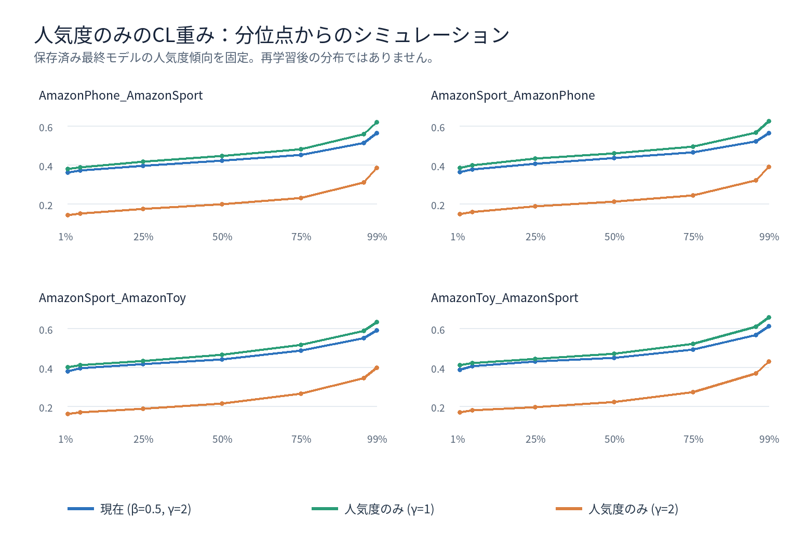

# 人気度傾向のみを使うCL重みのシミュレーション

作成日: 2026年11月17日

## 方法

4方向のseed 2022最終チェックポイントについて、保存済み診断JSONの人気度傾向の分位点を使用した。モデルは再学習せず、各ユーザーの人気度傾向 `p_u` を固定したと仮定し、`w_u = exp(-gamma × p_u)` を計算した場合の**重みの分位点**を求めた。人気度傾向の分位点を単調変換しているため、以下の値は小数丸めを除いて分位点レベルのシミュレーションである。ユーザー別の元データがJSONにないため、平均、標準偏差、バッチ内の実効重みはここから正確には算出できない。

## 生の重みの比較

| 方向 | 設定 | 5%点 | 中央値 | 95%点 | 95%点 / 5%点 |
| --- | --- | ---: | ---: | ---: | ---: |
| Phone→Sport | 現在 β=0.5, γ=2 | 0.369 | 0.421 | 0.512 | 1.386 |
| Phone→Sport | 人気度のみ γ=1 | 0.387 | 0.445 | 0.556 | 1.437 |
| Phone→Sport | 人気度のみ γ=2 | 0.150 | 0.198 | 0.309 | 2.066 |
| Sport→Phone | 現在 β=0.5, γ=2 | 0.376 | 0.434 | 0.519 | 1.382 |
| Sport→Phone | 人気度のみ γ=1 | 0.397 | 0.459 | 0.565 | 1.424 |
| Sport→Phone | 人気度のみ γ=2 | 0.158 | 0.211 | 0.319 | 2.028 |
| Sport→Toy | 現在 β=0.5, γ=2 | 0.394 | 0.441 | 0.550 | 1.395 |
| Sport→Toy | 人気度のみ γ=1 | 0.411 | 0.463 | 0.587 | 1.429 |
| Sport→Toy | 人気度のみ γ=2 | 0.169 | 0.214 | 0.345 | 2.043 |
| Toy→Sport | 現在 β=0.5, γ=2 | 0.405 | 0.449 | 0.564 | 1.394 |
| Toy→Sport | 人気度のみ γ=1 | 0.423 | 0.471 | 0.608 | 1.438 |
| Toy→Sport | 人気度のみ γ=2 | 0.179 | 0.221 | 0.369 | 2.067 |

`γ=1` の人気度のみ重みは、現行と近い選択の強さになる。`γ=2` は95%点と5%点の比が約2.0となり、現行の約1.4よりユーザー間の差が大きい。`γ=2` の生の重みが小さくなること自体は、CL損失の `Σ(w_i × loss_i) / Σw_i` で共通倍率が相殺されるため、CL全体の係数を弱める意味ではない。

この結果は、既存モデルの値を固定した**反実仮想の重み分布**である。人気度のみで再学習すると表現も変わるため、再学習後の分布や推薦精度は示さない。正確なユーザー別の反実仮想統計量は、学習用Python環境で更新済みの `analyze_cl_weights.py` をチェックポイントに対して実行すれば取得できる。
