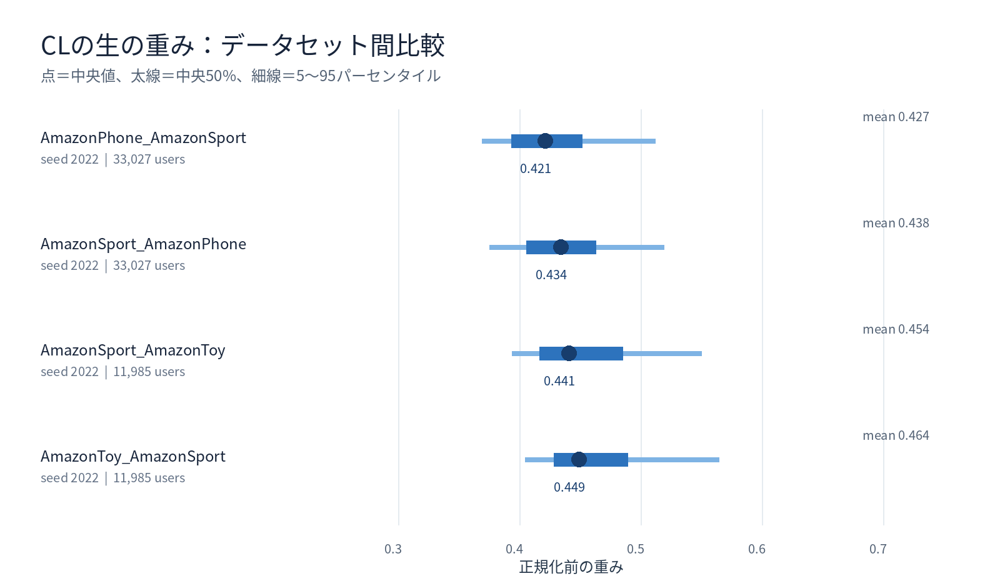

# 4方向におけるSelective-CL重みの比較報告

作成日: 2026年11月17日

## 対象と計算方法

保存済みProposedモデルのseed 2022、4方向の最終チェックポイントを対象とした。各方向で、**ソース領域の学習データに出現する重複ユーザー**を1人1回数え、モデルのCL重みを再計算した。学習中の各バッチを記録した結果ではない。

計算式は `alpha = 0.5 × 人気度傾向 + 0.5 × 意味的不一致度`、`生の重み = exp(-2 × alpha)`。4方向とも `gamma=2`、`beta=0.5`、`lambda_cl=0.01`、マルチモーダル特徴の有効率は100%だった。以下の「重み」はすべて**平均を1に直す前の値**である。

## 生の重みの統計量

| 方向 | ユーザー数 | 最小 | 5%点 | 25%点 | 中央値 | 平均 | 75%点 | 95%点 | 最大 | 標準偏差 |
| --- | ---: | ---: | ---: | ---: | ---: | ---: | ---: | ---: | ---: | ---: |
| Phone→Sport | 33,027 | 0.324 | 0.369 | 0.394 | 0.421 | 0.427 | 0.452 | 0.512 | 0.677 | 0.044 |
| Sport→Phone | 33,027 | 0.280 | 0.376 | 0.406 | 0.434 | 0.438 | 0.463 | 0.519 | 0.658 | 0.044 |
| Sport→Toy | 11,985 | 0.357 | 0.394 | 0.417 | 0.441 | 0.454 | 0.485 | 0.550 | 0.653 | 0.049 |
| Toy→Sport | 11,985 | 0.309 | 0.405 | 0.429 | 0.449 | 0.464 | 0.490 | 0.564 | 0.687 | 0.049 |

ToyとSportの組み合わせは、PhoneとSportの組み合わせより生の重みの平均が高い。ただし、ユーザー間の相対的な差は4方向でよく似ている。95%点と5%点の比は順に1.386、1.382、1.395、1.394である。

## 選択の強さと構成要素

| 方向 | 人気度傾向の標準偏差 | 意味的不一致度の標準偏差 | 重みの変動係数 | 有効サンプル数の割合 |
| --- | ---: | ---: | ---: | ---: |
| Phone→Sport | 0.110 | 0.028 | 0.104 | 98.93% |
| Sport→Phone | 0.106 | 0.036 | 0.100 | 99.02% |
| Sport→Toy | 0.114 | 0.026 | 0.108 | 98.84% |
| Toy→Sport | 0.114 | 0.033 | 0.107 | 98.88% |

有効サンプル数の割合は `(Σw)^2 / (N × Σw²)` で求めた。一様重みでは100%となる。全方向で約99%なので、現在の重み付けはユーザーを強く選別していない。人気度傾向の標準偏差は意味的不一致度の約3.0〜4.4倍であり、`beta=0.5` の合成リスクに生じるユーザー間の差は主に人気度傾向に由来すると考えられる。ただし、2成分の相関を計算していないため、各成分の寄与率を厳密に分解した値ではない。

## 解釈と限界

CL損失は `Σ(w_i × loss_i) / Σw_i` で計算する。そのため、方向間で生の重みの平均が0.427から0.464へ変わっても、平均値だけの違いは損失内で相殺される。推薦学習に効くのは、同じバッチ内のユーザー間での**相対的な重み差**である。

本報告は各方向1シードの最終チェックポイントを調べた結果であり、学習途中の重みの推移、実際のバッチ内の分布、シード間の変動は示さない。また、重みの分布だけから推薦精度への効果は証明できない。既存の5シード比較では、重み付きCLと一様CLのRecall@10平均差は方向ごとに約−0.00006〜−0.00012で、小さい値だった。

## 元データ

- [Phone→Sport](cl_weights_seed2022.json)
- [Sport→Phone](cl_weights_seed2022_Sport_Phone.json)
- [Sport→Toy](cl_weights_seed2022_Sport_Toy.json)
- [Toy→Sport](cl_weights_seed2022_Toy_Sport.json)
- [5シードの推薦結果](proposed_ablation/test_metrics.csv)
